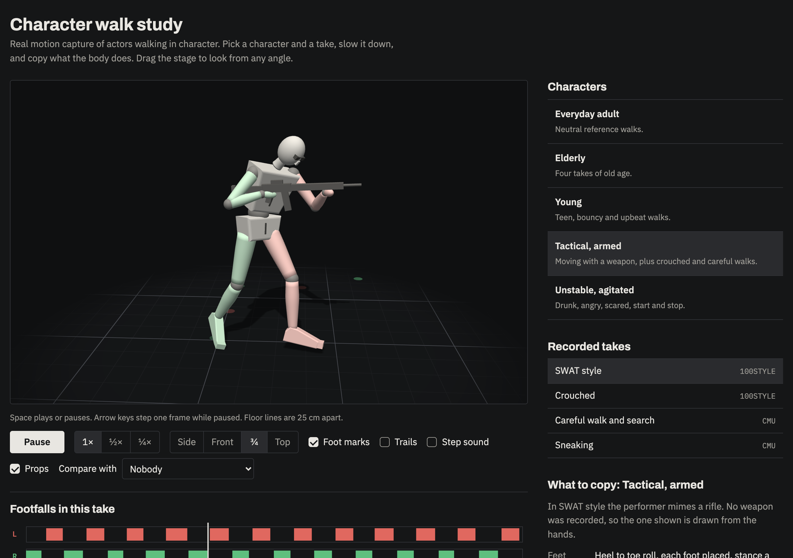

# Walk Study

A browser viewer for studying how different characters walk, built on real motion capture. Pick a character, slow the take down, and copy what the body does.

**Status:** exploration · one HTML page, no build step · no public demo yet



## What it does

- Plays 21 recorded takes in five groups: everyday adult, elderly, young, tactical and armed, unstable and agitated.
- Draws an artist's mannequin on the recorded joints, with the left side tinted red and the right side green.
- Keeps the figure centred while the floor grid moves under it, so you can watch a long walk in place. Floor lines are 25 cm apart.
- Side, front, three-quarter and top views. Drag the stage to look from any angle.
- Plays at full, half or quarter speed. Space pauses, and the arrow keys step one frame while paused.
- Shows foot marks, head and hand trails, and an optional click on each footfall.
- Shows a footfall timeline for the take: when each foot is on the ground, with speed, cadence and step length. Click or drag it to scrub.
- Compares two takes side by side.
- Lists what to copy for each character: feet, knees, hips, torso, arms, head, plus one thing to avoid and one drill.
- Draws a weapon prop where the hands show one being held. The Props checkbox hides it.

## Run it

Serve the folder with any static server:

```bash
python3 -m http.server 8000
```

Then open `http://localhost:8000/walk-study.html`. The page loads three.js and its fonts from the network, so it needs a connection.

## Where the motion comes from

| Source | What it is | Licence | Takes here |
|---|---|---|---|
| [100STYLE](https://www.ianxmason.com/100style/) | One performer walking in 100 acted styles, recorded in a sensor suit | CC BY 4.0 | 11 |
| [CMU Graphics Lab Motion Capture Database](http://mocap.cs.cmu.edu/) | Many people recorded with optical markers | Free to use, not for resale | 10 |

`clips.json` is a converted copy of those recordings. Each take was cut to a window of about 14 seconds (short recordings are kept nearly whole), resampled to 30 frames a second, scaled so the leg is 0.88 m long, and stored as joint positions in a frame that follows the hips. The tag beside each take in the viewer names its source.

## Ubisoft takes are not included

The viewer can also play two weapon-handling takes from Ubisoft La Forge's [LAFAN1](https://github.com/ubisoft/ubisoft-laforge-animation-dataset) dataset. That dataset is CC BY-NC-ND 4.0, which does not allow sharing converted copies, so they are not in this repository.

For private, non-commercial use you can build them on your own machine:

```bash
tools/get.sh dl --with-ubisoft
```

```bash
python3 tools/convert.py dl clips.json
```

This writes `clips.ubisoft.json` beside `clips.json`. The page loads that file when it is present and carries on without it when it is not. It is listed in `.gitignore`. Do not publish it.

## Rebuild the clips

You need Python 3 with numpy, plus curl and unzip.

```bash
tools/get.sh dl
```

```bash
python3 tools/convert.py dl clips.json
```

`tools/get.sh` downloads the source recordings into `dl/`. `tools/convert.py` reads them, picks the window of each recording to keep, measures the footfalls and writes `clips.json`. The list of takes and their labels is the `SPECS` table at the bottom of `tools/convert.py`.

## Files

| File | Purpose |
|---|---|
| `walk-study.html` | The whole viewer: markup, styles and script |
| `clips.json` | The 21 converted takes |
| `tools/get.sh` | Downloads the source recordings |
| `tools/convert.py` | Converts the recordings into `clips.json` |
| `docs/screenshot.png` | The picture above |
| `LICENSE` | MIT licence for the code |

## Known limits

- The numbers are approximate. Footfalls are detected from ankle speed and height, and some takes over-count steps.
- The 100STYLE performer walks in a wide circle, so those takes carry a slight constant turn.
- No weapon was recorded in any take. The prop is placed from the hand positions, and its type is a reading of how the hands are held.
- Checked in Chrome. Safari has not been checked.

## Credits

- **100STYLE.** Ian Mason, Sebastian Starke and Taku Komura, "Real-Time Style Modelling of Human Locomotion via Feature-Wise Transformations and Local Motion Phases", 2022. Licensed CC BY 4.0. The takes here are cut, resampled, rescaled and converted as described above.
- **CMU.** The data used in this project was obtained from mocap.cs.cmu.edu. The database was created with funding from NSF EIA-0196217. The BVH conversions were downloaded from [una-dinosauria/cmu-mocap](https://github.com/una-dinosauria/cmu-mocap).
- **three.js** r149, MIT licence, loaded from jsDelivr.
- **Fonts.** Archivo, IBM Plex Sans and IBM Plex Mono, loaded from Google Fonts.

## Licence

The code (`walk-study.html` and everything in `tools/`) is under the MIT licence. See [LICENSE](LICENSE).

`clips.json` is not covered by it. It is derived from the two datasets above and stays under their terms: keep the credits with it.
